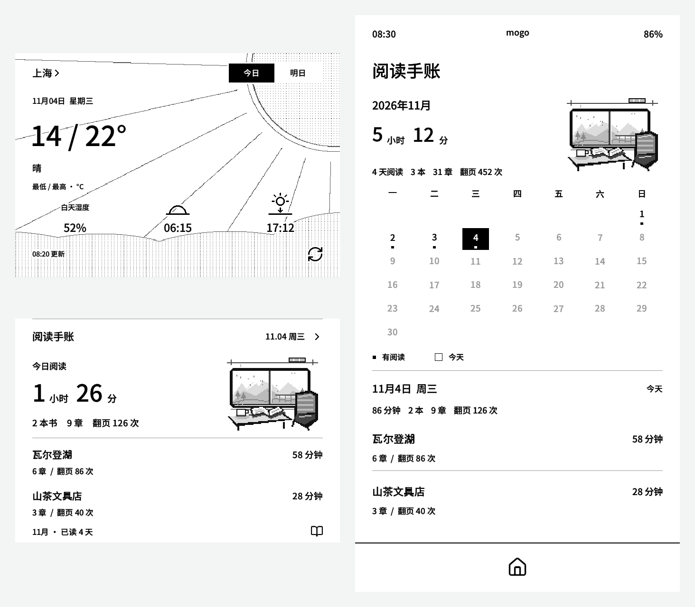
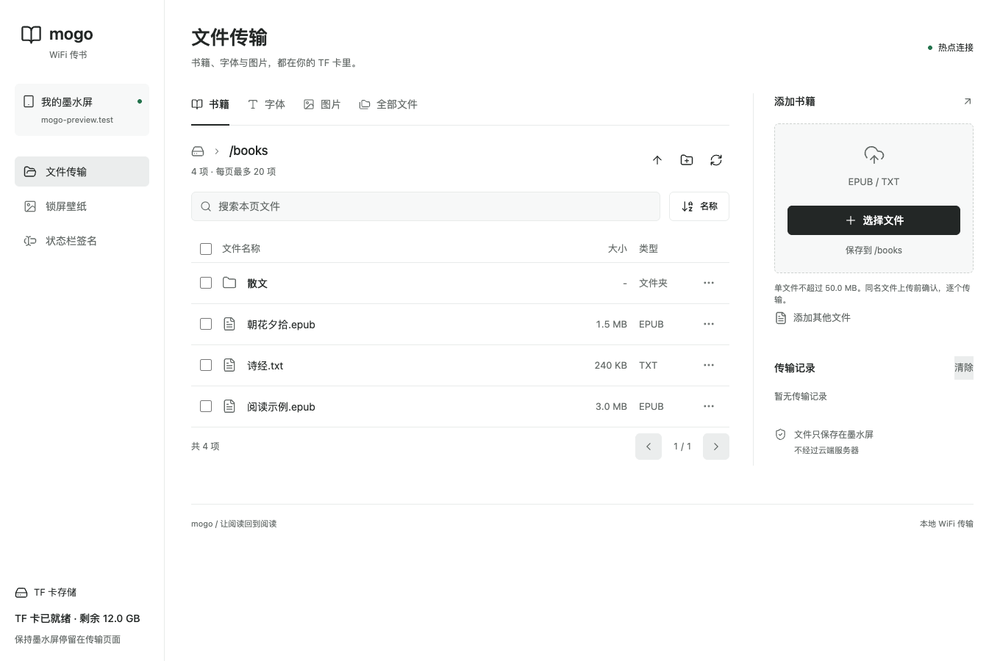

<div align="center">

<a href="https://mogo.mantake.shop"></a>

# mogo

### 为 Metalio E-INK4 Plus 打造的阅读固件

**把书装进口袋，把时间留给阅读。**<br>
阅读 EPUB、TXT 与传统 MOBI，用自己的字体和排版，记住每一次停下的位置。<br>
从书架到天气，从无线传书到阅读手账，都在这一块墨水屏上。

基于 [kiikoread](https://github.com/wegooo-cell/read-pico-reader) 开发。

[](https://github.com/chopper1026/mogo-e4p/releases/latest)
[](https://github.com/chopper1026/mogo-e4p/actions/workflows/build.yml)
[](#硬件)
[](LICENSE)

**[官网](https://mogo.mantake.shop)** &nbsp;·&nbsp; **[下载固件](https://github.com/chopper1026/mogo-e4p/releases/latest)** &nbsp;·&nbsp; **[网页刷机](https://mogo.mantake.shop/flash)**<br>
**[使用说明](https://mogo.mantake.shop/docs/firmware/manual/)** &nbsp;·&nbsp; **[更新日志](docs/CHANGELOG.md)** &nbsp;·&nbsp; **[开发文档](#开发文档)**

<br>

<a href="assets/readme/overview.png"></a>

<sub>当前开发源码的宿主绘图预览，使用示例数据；不是实屏照片，也不代表已发布版本。<a href="assets/readme/README.md">图片来源</a></sub>

</div>

<br>

## 读书，也照顾阅读之外的小事

mogo 是面向 **Metalio E-INK4 Plus（ESP32-S31）** 的独立阅读固件，基于 MindReset 阅读固件与 Metalio 板级实现适配，并非硬件厂商的官方固件。

- **书放在自己手里。** 从 TF 卡读取 EPUB、TXT、传统 MOBI，在书架直接归类，搜索、收藏，接着上次的位置读；整理分类不搬动原文件。
- **页面按自己的习惯来。** 字体、字号、间距、横竖排、章节题头、页眉页脚和阅读背景均可调整。
- **阅读时转个方向。** 顶部快捷栏第二排的旋转锁定图标开启重力自动旋转，再点锁定当前方向；退出阅读恢复竖屏。操作与边界见[阅读方向](docs/development/guides/READER_ORIENTATION.md)。
- **传书不必拔卡。** 通过已有 WiFi、设备热点或 USB 传文件；浏览器里就能整理目录、裁剪壁纸、修改签名。
- **首页不只是一张封面。** 最近阅读、天气、阅读手账与留白自由组合；阅读记录汇入当月日历。
- **翻页有不止一种方式。** 触摸、可配置按键与 BLE 翻页器；也可按需开启晃动翻页。

这里介绍当前源码的能力，安装包以 [Release](https://github.com/chopper1026/mogo-e4p/releases) 和对应[更新日志](docs/CHANGELOG.md)为准。功能的设备验证范围见[功能全景](docs/development/FEATURES.md)，不以预览图或编译成功代替实机验收。

## 快速开始

### 1. 安装固件

确认设备是 **Metalio E-INK4 Plus / ESP32-S31**。在电脑端 Chrome 或 Edge 中打开[网页刷机页](https://mogo.mantake.shop/flash)，连接 USB 数据线，核对所选固件的设备型号后按页面提示操作。刷写前先备份重要设置与阅读记录。

也可以在 [GitHub Releases](https://github.com/chopper1026/mogo-e4p/releases/latest) 下载完整 USB 刷机包，按包内 `README.txt` 操作，并用 `SHA256SUMS` 核对文件。

<details>
<summary>下载文件怎么选？</summary>

| 文件 | 用途 |
| :-- | :-- |
| `mogo-e4p-<版本号>-usb.zip` | 完整 USB 刷机包，包含操作说明、镜像与校验值 |
| `mogo-e4p-<版本号>-full.bin` | USB 单文件整机镜像，使用对应版本说明中的刷写方式 |
| `mogo-e4p-update-<版本号>.bin` | 设备升级用的应用镜像，不是整机镜像，不能当作完整 USB 包使用 |

已安装的用户可在设备设置中检查更新。首次安装或恢复设备时使用完整 USB 包，并按对应版本的说明操作。

</details>

### 2. 放入书籍

把 EPUB、TXT、传统 MOBI 放进 TF 卡的 `books/`。也可以进入设备的「文件管理」，选择 WiFi、热点或 USB 传输。MOBI 的支持范围见下方说明。

热点传书时，连接 **`mogo-XXXX`**，默认口令 **`mogo1234`**，再打开设备屏幕显示的地址。手机和电脑均可使用；传输期间让墨水屏停留在传输页面。日常传书和离线阅读不需要访问外网。

### 3. 开始阅读

从书架打开一本书。阅读时从屏幕底部上滑呼出工具栏，调整字体、排版和翻页方式。默认三键短按分别是上一页、工具栏、下一页，也可自行配置；新开书沿用记住的全屏偏好。

「阅读设置 → 书内样式」默认开启。关闭后，正文忽略书内字体、对齐与段前段后留白，并跳过 TXT 等书籍的空白行；字体、行距、段距、缩进和边距由阅读设置统一控制。标题、插图、链接和正常段落边界保留，切换按当前文字位置重新分页，不改写书籍；选择随重启和配置备份保存，重新开启可恢复书内样式。
常用按键翻页时，可先在「阅读设置 → 按键控制」绑定「触摸开关」，再开启「关闭触摸」。正文与阅读弹层会屏蔽触摸及上下边缘滑动，保留底部三键与实体键；按绑定的快捷键恢复触摸。返回书架或首页后触摸正常。

更多操作见[在线使用说明](https://mogo.mantake.shop/docs/firmware/manual/)。

## 功能一览

### 阅读，按自己的节奏

| | |
| :-- | :-- |
| **书籍与书架** | EPUB / TXT / 传统 MOBI、封面与列表、新建分类后直接选书、单本/批量归类、改名/排序/删除、离线搜索和收藏；原文件不变 |
| **正文与排版** | 自定义字体、抗锯齿、字号与间距、横竖排、四款章节题头、六槽页眉页脚与独立高度 |
| **进度与内容** | 续读、书签、章节目录、EPUB 脚注、插图与嵌入字体 |
| **翻页与显示** | 触摸与可配置按键、BLE 翻页器、可选晃动翻页、普通 / 水波纹效果、周期与手动全刷 |
| **个性化** | 阅读背景、自定义头像、锁屏壁纸、签名、冷暖前光与触摸震动 |

### 长按查字与查词

正文长按约半秒选字，拖动可扩选词语，松手打开离线释义卡片；长按两端圆点可调整选区，未收录的词语可点「逐字」查询。卡片全部文字使用当前阅读字体，缺字会提示；「上一屏 / 下一屏」查看完整读音、释义和例句。目录统一从底部工具栏进入，正文与留白长按不再打开目录。

未安装词库时，点卡片中的「下载安装」，设备通过已保存的 WiFi 从官网下载词库、来源和许可，校验后自动安装到 TF 卡并继续查词。请退出 USB 读卡模式并预留足够空间（当前包约 72 MB）；关闭卡片可取消，失败可重试。也可手工将 `chinese.mgdict` 放入 TF 卡根目录的 `dictionaries/`。安装后离线查询，释义覆盖取决于词库，生僻字显示取决于阅读字体。触摸、实屏和真实网络/TF 卡安装待验收；详见[阅读字典](docs/development/guides/READER_DICTIONARY.md)。

### MOBI 支持范围

原生读取无 DRM 的传统 MOBI6/KF7，支持未压缩、PalmDOC 压缩及 UTF-8/Windows-1252 编码。包含 MOBI6 和 KF8 两套内容的混合书固定读取 MOBI6，不随重开或缓存状态切换。书名、作者、JPEG/PNG 封面与插图、目录、续读和书签共用现有阅读入口；同分段的数字脚注可展开，跨分段脚注正文保留可读。

不支持 DRM、HUFF/CDIC、纯 KF8/AZW3、PRC、KFX、词典及固定版式；改扩展名不能转换格式。MOBI 使用系统或用户字体，不加载书内嵌入字体。原文件不修改，不需要电脑或云端转换。解析与缓存规则见 [MOBI 维护契约](docs/development/guides/MOBI.md)。当前实现经过宿主验证，实机显示、速度和真实 TF 卡恢复仍待验收。

<a id="epub-图片兼容--epub-image-compatibility"></a>
<details>
<summary>EPUB 图片兼容与资源限制</summary>

支持书内 JPEG、PNG 和静态 WebP 封面 / 插图，透明 WebP 合成到白底。样式表中 `body` 的单张背景图按页首插图处理，相对路径按样式表目录解析；不模拟浏览器的背景平铺或叠字，也不替换用户的阅读背景。

兼容 ZIP 文件名中的字面冒号，仍拦截外部地址和越界路径。旧自动封面缓存会重建，原 EPUB 不需要转换。WebP 每轴最多 8192、总像素最多 4,194,304，输出最多一屏；动画、超限、损坏或内存不足时按图片失败路径回退。独立图片页、头像和壁纸选图仍仅提供 JPG / PNG。

两个已报告的问题样本经过宿主检查与用户实机确认；这不代表其他书籍、实际内存峰值和解码耗时已全面验证。后端与许可见 [WebP 组件](components/webp_decoder/README.md)。

</details>

### 首页，留给你关心的内容

上下两个等高区域可分别选择最近阅读、天气、阅读手账或留白，同类非空组件不重复。长按区域，或从设置进入组件库即可更换。

最近阅读的书摘从已显示的 TF 书籍正文中选取，每向前推进4个正文页尝试换一句；过滤最近4条重复句，没有合适新句就保留原句。返回首页、重开同一页或刷新画面不会主动换句。

题头显示连续阅读天数与七本紧贴、由低到高的书脊。每天有效阅读满30分钟即达标：今天用黑色，往日用灰色，未达标用虚线；连续天数可跨月保留。

**天气**支持中文选城、今日 / 明日切换，灰阶背景随天气变化。数据来自官方 HTTPS 代理；平台未配置、停用或数据过期时不显示虚构预报。详情见[组件与天气](docs/development/guides/WEATHER.md)。

**阅读手账**记录每天读过的书、时长、章节和翻页次数，点开查看当月日历，搭配六幅轮换的像素插画。记录保存在本机，不补造历史明细；目前只查看当月，手账明细不包含在设置备份中。详情见[阅读手账](docs/development/guides/READING_JOURNAL.md)。

### 传书，一个浏览器就够

<a href="assets/readme/transfer.png"></a>

<sub>当前传书网页的浏览器截图，文件与存储容量为示例数据，未连接真实设备。</sub>

热点模式不需要路由器，已有 WiFi 模式让手机、电脑与设备在同一网络下传书。网页资源全部内嵌，无需外网加载；也可以用 USB 直接读写 TF 卡。

无线网络设置最多保存 8 个 WiFi，兼容旧单网络。附近列表每页 6 个，标记已保存网络；「已保存」列表可连接、改密码和逐个确认遗忘，存满不覆盖。默认连接最近选择的网络，不自动轮换；现有 TF 配置备份只包含默认网络。详情见[中文使用说明](README.zh-CN.md)。

- **文件工作台：** 浏览目录、上传原文件、新建文件夹、重命名、复制和确认删除。
- **壁纸：** 拖动、缩放并裁剪，输出适合竖屏的 JPG。
- **签名：** 预览文字，确认保存后写入设备配置。

<a id="传书网页--transfer-workspace"></a>
<details>
<summary>目录、上传限制与断连处理</summary>

书籍、字体、图片快捷目录对应 `books`、`fonts`、`pictures`，默认上传校验对应格式；「添加其他文件」允许向当前目录上传任意格式和空文件，根目录及其他子目录默认接受任意文件。每页最多 20 项，搜索与排序只作用于当前页。删除文件夹包含其内容，批量删除需要确认。

上传逐个发送原文件，同名替换需要确认。本次网页会话保留最近 40 条传输记录，失败可重试；断连后先核对文件是否已保存，再决定是否替换。字体上限 32 MiB，图片 20 MiB，书籍限制由设备返回。壁纸输出 684 × 1216 JPG，不超过 2 MiB。签名预览仅为示意，点击保存才写入设备。离开设备的传输页面后服务停止。

</details>

### 锁屏与待机

自动锁屏、密码、自定义锁屏图、拿起唤醒和阅读恢复检查点各自配合；锁屏前保存阅读位置。待机方式可选「彻底关机」「仅浅睡」「浅睡后关机」，默认仅浅睡。

本地开发版的**设置 → 锁屏样式 → 阅读票根**可选「透明背景」或「封面背景」，默认透明。透明背景保留锁屏前页面，封面背景以最近书籍封面铺满屏幕；两种背景保留相同票面、票内封面、书摘与阅读统计。选择随重启及设置备份保存；旧设置与旧备份使用透明背景，切换后自动重建匹配的锁屏缓存。冷启动缺少缓存时透明票根使用白底，封面背景缺少封面缓存或内存不足时使用灰底。

<a id="定时待机关机--timed-standby-power-off"></a>
<details>
<summary>定时关机、唤醒与备份兼容</summary>

在「设置 → 显示 → 待机方式」选择「浅睡后关机」，再选 10 / 30 / 60 分钟。从非定时方式切入时默认 10 分钟；再次打开页面保留已保存的档位。

计时从锁屏画面显示完成、进入浅睡时开始，自动锁屏与手动锁屏均生效，与无操作锁屏的等待时间独立。按电源键或已启用的拿起唤醒会取消本轮计时，再次进入锁屏浅睡重新计时；密码输入期间不计时，重新等待唤醒时开始新一轮。

到时保留锁屏画面与阅读恢复检查点，沿用关机流程；之后长按电源键约 1 秒开机，已设密码仍需验证。关机失败回退无期限锁屏浅睡与既有故障恢复，不把定时器唤醒视为解锁，不连续重试。电源菜单「关机」始终立即关机。

设置保存在 NVS 与配置备份中；新版可读原备份，旧固件不能恢复含新增定时档的备份。真实待机电流、定时与断电行为仍需专项设备验证。

</details>

## 硬件

| 项目 | 当前目标 |
| :-- | :-- |
| 开发板 | Metalio E-INK4 Plus |
| 主控 / 工具链 | ESP32-S31 / ESP-IDF v6.1，preview 目标 |
| 屏幕 | 4.7 英寸，1216 × 684，8-bit 并口；竖屏逻辑尺寸 684 × 1216 |
| 存储 | 16 MB Flash，80 MHz；Octal PSRAM，200 MHz；TF 卡使用 SDMMC 4-bit |
| 触摸 / 运动 | FT6336U / SC7A20H |
| 板级与电源 | TPS65185、TCA9555、BQ27220、CX25601N、PCF8563 |

<details>
<summary>主要引脚与兼容接口</summary>

| 总线 / 功能 | GPIO |
| :-- | :-- |
| I2C SDA / SCL | 0 / 1 |
| TCA9555 / SC7A20H 共用中断 | 2 |
| EPD D0–D7 | 8–15 |
| EPD XCL / XLE / XOE / XSTL | 16 / 17 / 18 / 4 |
| EPD SPV / CKV / MODE / BORDER | 35 / 40 / 19 / 37 |
| TF CLK / CMD / D0–D3 | 24 / 25 / 20–23 |
| 冷 / 暖前光 | 6 / 7 |
| 顶部按键 | 61 |

引脚以[板级实现](components/board_support/board_metalio_e4p.c)和 [TF 卡驱动](components/board_support/board_sd.c)为准。`cst836u_*`、`fca9555_*`、`device_power_*` 是仍在使用的兼容接口，不代表产品使用旧芯片。硬件时序、供电与唤醒边界见[板级说明](components/board_support/README.md)。

</details>

## 从源码构建

先安装并激活 **ESP-IDF v6.1**。ESP32-S31 仍是 preview 目标，以下 `idf.py` 命令都必须带 `--preview`。

```sh
git clone https://github.com/chopper1026/mogo-e4p.git
cd mogo-e4p

. "$IDF_PATH/export.sh"
idf.py --preview set-target esp32s31
idf.py --preview build
```

`IDF_PATH` 应指向本机的 ESP-IDF v6.1 安装目录。产品配置使用 `sdkconfig.defaults`；已有 `sdkconfig` 会保留旧值，修改 defaults 后应核对生成配置。

<details>
<summary>CI 配置、宿主回归与本地刷写</summary>

CI 在产品 defaults 后叠加编译警告配置，不切换硬件目标：

```sh
idf.py --preview -DSDKCONFIG_DEFAULTS="sdkconfig.defaults;sdkconfig.ci" set-target esp32s31
idf.py --preview -DSDKCONFIG_DEFAULTS="sdkconfig.defaults;sdkconfig.ci" build
python3 tools/check_architecture.py
python3 tools/run_reader_baseline.py
```

宿主回归保留 ASan / UBSan。编译器、Python 图像依赖和各套件要求见[上手指南](docs/ONBOARDING.md)与[工具入口](tools/README.md)。编译、宿主回归、刷写校验、设备启动与实屏验收是不同验证层级。

开发构建完成后，可先准备本次产品镜像：

```sh
python3 tools/flash_fast.py prepare --build-dir build
```

需要本地刷写且已确认目标设备与操作授权时，按[项目刷机说明](.agents/skills/mogo-e4p-flash/SKILL.md)执行 `python3 tools/flash_fast.py flash --yes`。脚本默认及上限为 180 秒，动态识别活动应用分区，不自动退回整机擦写。不要刷入旧包或把局部写入失败当作成功。

本地测试沿用当前正式版本号，用日期和说明区分；产物留在忽略的构建目录，不覆盖已经发布的同版本文件。

</details>

<!-- tidy:start -->
## 开发文档

[项目开发总入口](docs/development/INDEX.md)
<!-- tidy:end -->

| | |
| :-- | :-- |
| [开发上手](docs/ONBOARDING.md) | 环境准备、构建、测试与设备验证 |
| [架构说明](docs/ARCHITECTURE.md) | 页面、阅读、显示、存储与服务的职责边界 |
| [功能全景](docs/development/FEATURES.md) | 当前能力、实现入口与验证范围 |
| [测试与工具](tools/README.md) | 宿主回归、原生预览、资源生成和发布工具 |
| [显示刷新契约](docs/development/designs/DISPLAY_REFRESH.md) | 刷新意图、波形出口与失败恢复 |
| [阅读性能](docs/development/guides/READER_PERFORMANCE.md) | 资源归属、诊断开关与测量方法 |
| [贡献指南](CONTRIBUTING.md) / [Agent 入口](AGENTS.md) | 贡献要求、产品约束与提交规范 |

早期[移植评估](docs/development/history/porting/移植适配方案.md)、[中文旧版说明](README.zh-CN.md)和[日文旧版说明](README.ja-JP.md)保留为历史资料，不作为当前 S31 硬件、构建或发布状态的依据。当前产品页面以 `main/CMakeLists.txt` 和 `main/app/app_registry.c` 为准；旧板演示页与 `continuous_du` 已移除，旧名称的有效兼容接口仍保留。

## 反馈与贡献

使用中遇到问题，或有新的想法，可以提交 [Issue](https://github.com/chopper1026/mogo-e4p/issues) 或通过[官网反馈](https://mogo.mantake.shop/feedback)联系维护者。请附设备型号、固件版本、复现步骤；分享日志前删去 WiFi 密码和其他私人信息。

代码贡献前请阅读[贡献指南](CONTRIBUTING.md)与[中文提交规范](docs/COMMIT_CONVENTION.md)。

## 致谢与许可

特别感谢原项目 [kiikoread](https://github.com/wegooo-cell/read-pico-reader)，mogo 在其基础上继续开发与适配。

感谢 [MindReset](https://github.com/MindReset/read_pico_firmware) 的固件基础、Metalio 的 E-INK4 Plus 板级实现，以及 [epdiy](https://github.com/vroland/epdiy) 和其他上游项目。完整来源与许可见[第三方声明](THIRD_PARTY_NOTICES.md)。

本仓库按内容范围适用不同许可，**并非整个仓库统一采用同一许可**。既有代码与历史版本保留 Apache-2.0 或各自组件许可；明确标注个人学习许可的新增原创内容允许个人学习、研究和测试，官方未修改版本也可用于个人非商业阅读，商用需权利人书面授权。第三方和既有授权不因本声明改变。详见 [LICENSE](LICENSE)。
